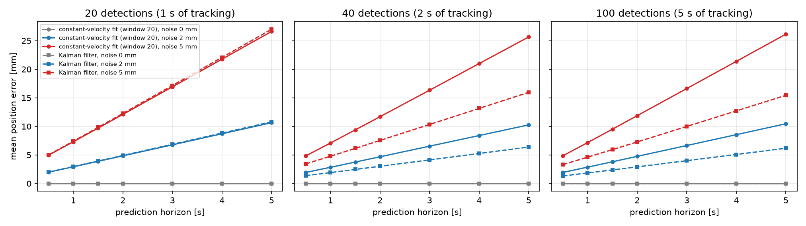
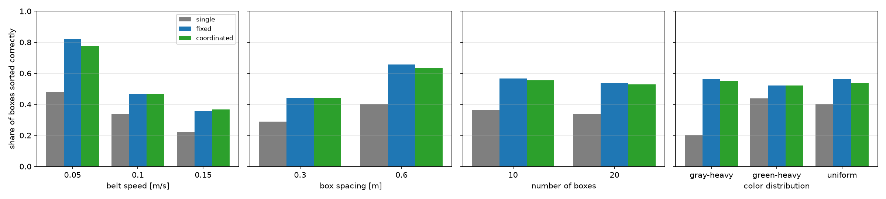
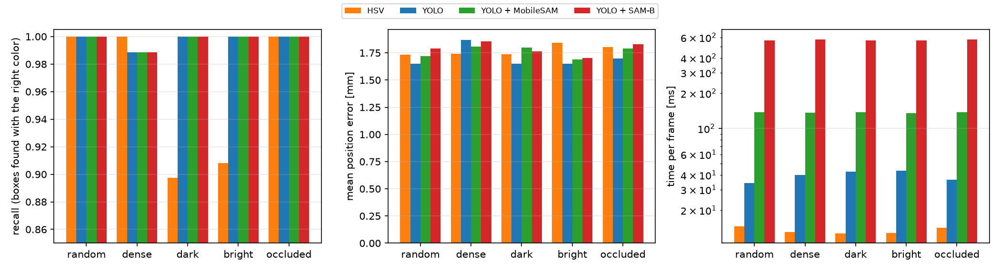

# Vision-Based Dynamic Multi-Robot Sorting on a Conveyor Belt

CS449/549 term project, Bilkent University.

Two manipulators in RAI share a moving conveyor. In **autonomous mode** Robot 1
sorts colored boxes into target regions while Robot 2 removes gray boxes. In
**command mode** a user instruction like *"pick a blue box and place it at B"*
is executed by choosing a matching box and robot. The robots stand on opposite sides of the belt at its
middle and work in the BotOp physics simulation (PhysX, real time): boxes are held by friction between the
fingers and placed physically.

### Results at a glance

| | |
|---|---|
| Detection (HSV / YOLO / YOLO + SAM, top camera) | 99 to 100 % recall at normal lighting, position error 1.6 to 1.9 mm mean |
| Prediction, 3 s ahead, 2 mm noise | 4.1 mm (Kalman, after 2 s of tracking), 6.5 mm (window fit) |
| Boxes sorted, 36 streams, 0.05 to 0.15 m/s | Robot 1 alone 35 %, two robots 54 to 55 % (82 % at 0.05 m/s) |
| Grasps that hold / placed boxes in the right region | 95 to 100 % / 100 % |
| Command mode, 160 random commands | 82 to 100 % correct |
| Scenario matrix (speed x position x neighbours) | 68 of 68 cells as expected, no arm contact |

Details and the commands that reproduce every number are under [Experiments](#experiments).

### Demo videos

Top-camera recordings (BotOp physics, real time), in the release
[demos-2026-11-21](https://github.com/mehmetdzdr/cs449-robotics-project/releases/tag/demos-2026-11-21):

| video | command |
|---|---|
| [autonomous_coordinated_gt.mp4](https://github.com/mehmetdzdr/cs449-robotics-project/releases/download/demos-2026-11-21/autonomous_coordinated_gt.mp4): both robots, ground-truth detections, 60 s: 7 of 7 sorted | `run_autonomous.py --mode coordinated --duration 60` |
| [autonomous_coordinated_hsv.mp4](https://github.com/mehmetdzdr/cs449-robotics-project/releases/download/demos-2026-11-21/autonomous_coordinated_hsv.mp4): the same with the HSV detector in the loop: 7 of 7 sorted | `run_autonomous.py --mode coordinated --detector hsv --duration 60` |
| [command_mode.mp4](https://github.com/mehmetdzdr/cs449-robotics-project/releases/download/demos-2026-11-21/command_mode.mp4): three commands in a row | `run_command.py "pick a red box and place it at A" "put a gray box into the bin" "pick a green box and place it at B"` |
| [clear_and_sort.mp4](https://github.com/mehmetdzdr/cs449-robotics-project/releases/download/demos-2026-11-21/clear_and_sort.mp4): Robot 2 removes a gray box blocking a red one, Robot 1 sorts the red box | `run_autonomous.py --scene clear-and-sort --duration 50` |

With the HSV detector in the loop, 10 runs of 60 s (0.1 m/s) sorted 5 to 8 boxes each with no lost picks; on the
same streams ground truth sorted slightly more (27 against 24 on four streams, one grasp failure more per two
runs). BotOp's camera renders nothing while the loop plans, so images are stamped with the time they show (#171).
The manipulation benchmarks below use ground-truth detections; the detectors are measured separately.

## Pipeline

```
camera ─► perception ─► prediction ─► coordination ─► planning (KOMO) ─► joint trajectories
                                          ▲
                              command (optional)
```

All modules exchange only the types in
[`src/conveyor_sort/interfaces.py`](src/conveyor_sort/interfaces.py), so each
module can be developed and tested against simulator ground truth before the
upstream module is ready.

## Layout

| Path | Responsibility | Owner |
|---|---|---|
| `src/conveyor_sort/sim/` | RAI scene, conveyor motion, camera | S. E. Hyder |
| `src/conveyor_sort/perception/` | HSV baseline | O. E. Yakar |
| `src/conveyor_sort/perception/` | YOLO / SAM, 3D localization | M. Dizdar |
| `src/conveyor_sort/prediction/` | Constant-velocity and Kalman prediction | A. Müftüoğlu |
| `src/conveyor_sort/coordination/` | Task allocation, workspace priority, clear-and-sort | A. Müftüoğlu |
| `src/conveyor_sort/planning/` | KOMO pick-and-place on moving boxes | H. Arkca |
| `src/conveyor_sort/command/` | Command-driven mode | O. E. Yakar |
| `evaluation/` | Benchmarks and metrics | S. E. Hyder |
| `assets/` | RAI `.g` configuration files | — |
| `scripts/` | Entry points (autonomous / command mode) | — |
| `tests/` | Unit and ground-truth tests | everyone |

## Setup

`robotic` (RAI) has Linux wheels only: on Windows, work inside WSL (Ubuntu). Headless Linux (SSH, CI, WSL
without a display) needs `sudo apt install libglu1-mesa liblapack3 xvfb` and `xvfb-run -a` in front of every
command that renders (see Troubleshooting).

```bash
git clone https://github.com/mehmetdzdr/cs449-robotics-project.git && cd cs449-robotics-project
python -m venv .venv && source .venv/bin/activate
pip install -e ".[dev]"            # core: robotic (RAI), numpy, opencv
pip install -e ".[learning]"       # optional: YOLO, SAM
python scripts/check_env.py        # must end with ENVIRONMENT OK
python scripts/view_scene.py       # opens the scene in the RAI viewer
python scripts/run_conveyor.py --view   # boxes moving on the belt, no robots
python scripts/run_autonomous.py --view   # autonomous mode: two coordinated robots sort the boxes
python scripts/run_command.py "pick a blue box and place it at B" --view   # command mode
pytest -m "not slow"                # fast suite (as in every PR); plain `pytest` adds the slow physics scenarios
```

Requires Python 3.10 or newer.

### Troubleshooting

| Symptom | Fix |
|---|---|
| `ImportError: libGLU.so.1` (Linux) | `sudo apt install libglu1-mesa` |
| `ImportError: liblapack.so.3` or another missing `.so` (minimal Linux installs) | `sudo apt install liblapack3 libgl1 libfreetype6 libxrandr2 libxxf86vm1 libxi6` |
| `GLFW error ... DISPLAY environment variable is missing` (headless Linux, SSH, CI) | `sudo apt install xvfb`, then prefix commands with `xvfb-run -a`, e.g. `xvfb-run -a pytest` |
| `gripper 0 was not launched` from BotOp | `robotic` 0.4.2 does not launch simulated grippers: `pip install -U 'robotic>=0.4.3'` |
| `FreeType Error: Failed to load font` warning | Harmless; only text overlays in the viewer are disabled |

## Demos

The robots stand on opposite sides of the belt at its middle (#154); every demo runs on the BotOp physics
simulation in real time. Both entry points take `--speed`, `--spacing`, `--seed`, `--detector gt|hsv|yolo|sam|sam_b`, `--view` (RAI viewer)
and `--video out.mp4` (top-camera video; headless Linux: prefix with `xvfb-run -a`).

```bash
python scripts/run_autonomous.py --view                          # two coordinated robots
python scripts/run_autonomous.py --mode single --view            # Robot 1 alone: gray boxes leave the belt
python scripts/run_autonomous.py --mode fixed --speed 0.15 --view   # Robot 2 removes gray boxes
python scripts/run_autonomous.py --scene clear-and-sort --view   # a red box blocked by gray boxes: Robot 2 clears one first
python scripts/run_command.py "pick a blue box and place it at B" "put a gray box into the bin" --view
python scripts/run_command.py --view                             # type commands, empty line to quit
```

## Experiments

```bash
python evaluation/run_experiment.py evaluation/configs/example.json --out results/runs.csv
```

The JSON config sets belt speed, box spacing, number of boxes, color distribution, seed, detector and mode (single,
fixed, coordinated). Every run is a BotOp physics simulation in real time (friction grasp, physical place; the
kinematic backend was removed in #113 and #114). Each run appends one row to the CSV: grasp success rate, sorting
accuracy, missed boxes, failures by stage (grasp, slip, drop, ...), planning time, completion time, throughput
(boxes per minute), tracking error and arm contacts.

### Perception benchmark

```bash
python evaluation/benchmark_perception.py      # needs .[learning] and the weights; results/perception.csv
```

40 random scenes per condition with the arms partly over the belt (not the scenes YOLO was trained on),
about 170 to 185 well-visible boxes each; "an arm over a box": one gripper 5 to 15 cm above a random box (#110).
"Partly hidden": boxes a third to two thirds visible. Layout of #154 (Robot 2 now in the image), CPU (WSL):

| condition | detector | recall | precision | position error mean / max | mask IoU | partly hidden found | time per frame |
|---|---|---|---|---|---|---|---|
| random arrangement | HSV | 1.000 | 1.000 | 1.7 / 3.4 mm | 0.976 | 2 of 2 | 15 ms |
|  | YOLO | 1.000 | 1.000 | 1.6 / 3.4 mm | (no mask) | 2 of 2 | 34 ms |
|  | YOLO + MobileSAM | 1.000 | 1.000 | 1.7 / 3.7 mm | 0.985 | 2 of 2 | 138 ms |
|  | YOLO + SAM-B | 1.000 | 1.000 | 1.8 / 3.8 mm | 0.979 | 2 of 2 | 565 ms |
| dense (touching boxes) | HSV | 1.000 | 1.000 | 1.7 / 4.7 mm | 0.983 | - | 13 ms |
|  | YOLO | 0.988 | 1.000 | 1.9 / 6.0 mm | (no mask) | - | 40 ms |
|  | YOLO + MobileSAM | 0.988 | 1.000 | 1.8 / 5.5 mm | 0.958 | - | 137 ms |
|  | YOLO + SAM-B | 0.988 | 1.000 | 1.9 / 4.4 mm | 0.958 | - | 575 ms |
| image 40 % darker | HSV | 0.897 | 1.000 | 1.7 / 3.4 mm | 0.889 | 2 of 2 | 13 ms |
|  | YOLO | 1.000 | 1.000 | 1.6 / 3.4 mm | (no mask) | 2 of 2 | 43 ms |
|  | YOLO + MobileSAM | 1.000 | 1.000 | 1.8 / 3.8 mm | 0.981 | 2 of 2 | 137 ms |
|  | YOLO + SAM-B | 1.000 | 1.000 | 1.8 / 3.8 mm | 0.979 | 2 of 2 | 565 ms |
| image 40 % brighter | HSV | 0.908 | 1.000 | 1.8 / 11.6 mm | 0.898 | 2 of 2 | 13 ms |
|  | YOLO | 1.000 | 1.000 | 1.6 / 3.4 mm | (no mask) | 2 of 2 | 44 ms |
|  | YOLO + MobileSAM | 1.000 | 1.000 | 1.7 / 3.7 mm | 0.984 | 2 of 2 | 136 ms |
|  | YOLO + SAM-B | 1.000 | 1.000 | 1.7 / 3.7 mm | 0.984 | 2 of 2 | 567 ms |
| an arm over a box | HSV | 1.000 | 1.000 | 1.8 / 6.0 mm | 0.981 | 3 of 3 | 14 ms |
|  | YOLO | 1.000 | 1.000 | 1.7 / 6.0 mm | (no mask) | 2 of 3 | 36 ms |
|  | YOLO + MobileSAM | 1.000 | 1.000 | 1.8 / 6.1 mm | 0.985 | 2 of 3 | 137 ms |
|  | YOLO + SAM-B | 1.000 | 1.000 | 1.8 / 6.2 mm | 0.981 | 2 of 3 | 578 ms |

No detector reported a wrong color and Robot 2 in the image gives no false detection: the numbers equal those
before #154 within 1 point. The renderer has no light control: "darker" and "brighter" scale the image. HSV is the
fastest and as accurate as the learned detectors under the lighting it was tuned for, but loses 9 to 10 % of the
boxes when the brightness changes. YOLO is unaffected. SAM adds masks but no accuracy, for 4 to 17 times the time.
On BotOp images (`benchmark_perception_scenarios.py`): HSV finds every touching box of the 48 layouts of #98,
YOLO and SAM merge a touching 3 x 3 cluster (3 of 9 found); a box right under the hand is hidden by the wrist and
not found, the tracker keeps it (`max_age` 3 s).

### Command-mode correctness

```bash
python evaluation/benchmark_command_physics.py --jobs 8   # results/command_physics.csv
```

Random commands (color, destination and phrasing) are executed one after the other on a running belt and
checked on the simulator state (BotOp physics, 40 commands per configuration):

| belt | stream | correct | time per command, mean / max | failures |
|---|---|---|---|---|
| 0.1 m/s (a box every 4 s) | normal | 82 % | 20.2 / 56.3 s | grasp 4, release 3 |
| 0.2 m/s (a box every 2 s) | normal | 100 % | 18.9 / 43.8 s | - |
| 0.1 m/s | every box blocked by a gray one 8 cm in front | 88 % | 20.3 / 68.1 s | grasp 4, place 1 |
| 0.2 m/s | every box blocked | 92 % | 17.5 / 35.4 s | grasp 3 |

Robot 2 carries out the bin commands (12 of 40), Robot 1 the rest.
### Manipulation benchmark

```bash
python evaluation/benchmark_manipulation.py --jobs 6     # 117 physics runs in real time, about 1.5 h with 6 at once
```

Three configurations on the same box streams (ground-truth detections, BotOp physics): `single` (Robot 1 alone),
`fixed` (Robot 1 sorts, Robot 2 removes gray boxes), `coordinated` (fixed roles plus clearing of blocked boxes).
One arm over the belt at a time (the robots face each other across it, #154). 36 streams: speed 0.05 / 0.1 /
0.15 m/s, 10 / 20 boxes, spacing 0.3 / 0.6 m, three color distributions. Share of all boxes sorted correctly:

| | single | fixed | coordinated |
|---|---|---|---|
| all 36 streams | 34.6 % | 54.8 % | 53.7 % |
| 0.05 m/s | 47.8 % | 82.2 % | 77.8 % |
| 0.1 m/s | 33.9 % | 46.7 % | 46.7 % |
| 0.15 m/s | 22.2 % | 35.6 % | 36.7 % |
| spacing 0.3 m | 28.9 % | 44.1 % | 44.1 % |
| spacing 0.6 m | 40.4 % | 65.6 % | 63.3 % |
| gray-heavy colors | 20.0 % | 56.1 % | 55.0 % |
| green-heavy colors | 43.9 % | 52.2 % | 52.2 % |
| throughput [boxes/min] | 2.8 | 4.3 | 4.3 |

836 attempts; 95 to 100 % of the grasps hold, every placed box lies in the right region. Boxes are lost mostly
because no robot was free in time (a physical pick and place takes about 10 s). Planning takes 1.5 s per pick and
place (the physical task also plans the retreat and re-plans displaced boxes). No arm contact in the 117 runs
(closest 1.3 cm). Three more streams (0.03 / 0.05 / 0.08 m/s, 20 boxes) contain 6 blocked pairs each, a gray box
8 cm in front of a colored one: single 33 %, fixed 40 %, coordinated 67 % sorted (11 of 14 clearings succeeded).

### Scenario matrix

```bash
python evaluation/scenario_matrix.py --jobs 6     # 68 physics runs; tests/scenarios/test_matrix.py checks the same cells
```

Speed {0.05, 0.1, 0.2, 0.3 m/s} x target position across the belt {centre, near edge, far edge} x neighbourhood
{free, front, back, front and back, both sides, surrounded, front and side}, with the expected outcome of every cell:
68 of 68 as expected, no arm contact, no box left in a gripper. Free and side neighbours: grasped along the belt;
front / back: grasped across it; front and side (both grasp axes blocked): Robot 2 removes one gray box, then
Robot 1 sorts (0.05 m/s; faster, it is reported infeasible); surrounded: reported infeasible; boxes faster than
0.25 m/s are not picked.

### Blocked and surrounded targets

```bash
python evaluation/benchmark_clearing.py --jobs 6     # 30 physics runs per (layout, speed) cell, 540 in all
```

| neighbourhood | sorted | reported infeasible | extra time against a free target |
|---|---|---|---|
| front, back, front and back (0.05 to 0.2 m/s) | 100 % | - | +0.4 s (grasped across the belt) |
| front and side, 0.05 m/s | 100 % | - | +12.6 s (one removal by Robot 2) |
| front and side, 0.1 / 0.2 m/s | - | 100 % | - |
| surrounded (0.05 to 0.2 m/s) | - | 100 % | - |

No arm contact in the 540 runs.

### Prediction benchmark

```bash
python evaluation/benchmark_prediction.py     # results/prediction.csv
```



Mean position error 3 s ahead (the lead time of a pick), 500 trials: without noise both predictors are exact.
With 2 mm detection noise the window fit stays at 6.5 to 6.8 mm however long the box has been tracked; the
Kalman filter is equal after 1 s of tracking (6.9 mm) and reaches 4.1 mm after 2 s and 4.0 mm after 5 s.
With 5 mm noise: 16.3 to 16.9 mm against 17.2, 10.3 and 10.0 mm.

On the physical belt (0.1 m/s, 60 s of BotOp simulation, both predictors on the same recording):

```bash
python evaluation/benchmark_prediction_physics.py     # results/prediction_physics.csv
```

The simulation steps are irregular (0.05 to 0.06 s on average, up to 0.58 s). With ground-truth detections both
predictors are exact (at most 0.01 mm). With the HSV detector on BotOp's images the window fit stays at 1.7 to
1.9 mm from 0.5 to 3 s ahead, while the Kalman filter grows from 2.1 to 3.7 mm: on the physical belt the window
fit is the better predictor, unlike in the synthetic benchmark.

### Figures and tables

```bash
pip install -e ".[eval]"
python scripts/fetch_results.py       # the YOLO weights and the raw results of the release (or run the benchmark_*.py scripts)
python evaluation/make_figures.py
```

Regenerates everything in `evaluation/figures/` from the logged results: the plots shown here and
[`tables.md`](evaluation/figures/tables.md) with all result tables. The committed figures and tables come from the
release [results-2026-11-21](https://github.com/mehmetdzdr/cs449-robotics-project/releases/tag/results-2026-11-21):
`yolo_boxes.pt` (the fine-tuned YOLO weights, into `weights/`) and the benchmark CSVs (into `results/`), with
`SOURCES.md` naming the script and the PR behind each file. From a fresh clone, `fetch_results.py` followed by
`make_figures.py` gives the committed `tables.md` byte for byte and the same figures pixel for pixel (the PNG bytes
depend on the matplotlib version).





## Synthetic dataset for YOLO

Labels come from the simulator's ground-truth segmentation, so nothing is labelled by hand:

```bash
python scripts/generate_dataset.py --n 2000 --out data/boxes     # about 0.3 s per image
python scripts/generate_dataset.py --n 8 --out data/preview --preview   # draws the labels for a visual check
```

Classes: `0 red, 1 green, 2 blue, 3 gray`. Output is in Ultralytics layout with a `data.yaml`.

## YOLO detector

```bash
pip install -e ".[learning]"
python scripts/generate_dataset.py --n 2000 --out data/boxes
python scripts/train_yolo.py --data data/boxes/data.yaml --epochs 30     # needs a GPU; about 14 min on an RTX 3070
```

Fine-tunes the pretrained `yolo11n` on the synthetic dataset and copies the best weights to
`weights/yolo_boxes.pt`, where `YoloDetector` looks for them. The weights (5.6 MB) are not in git.

Validation (400 images, 1793 boxes): mAP50 0.995, mAP50-95 0.995, precision and recall 0.999. On 25 new random
scenes with the arms over the belt: 115 of 115 well-visible boxes found, no false positives, position error
1.7 mm mean / 3.6 mm max, 29 ms per frame on the GPU.

## SAM segmentation

`SamDetector` prompts SAM with the YOLO boxes and localizes each box from its mask. The SAM weights are
downloaded by Ultralytics into `weights/` on first use (MobileSAM 41 MB, SAM-B 375 MB).

Measured on 15 new random scenes (74 well-visible boxes, RTX 3070 Laptop GPU), all boxes found, no false positives:

| detector | position error mean / max | mask IoU mean / min | time per frame |
|---|---|---|---|
| YOLO, depth inside the bounding box | 1.7 / 3.6 mm | (no mask) | 29 ms |
| YOLO + MobileSAM (1280 px) | 1.7 / 3.8 mm | 0.975 / 0.933 | 117 ms |
| YOLO + SAM-B (1024 px) | 1.8 / 3.6 mm | 0.972 / 0.849 | 281 ms |

## Milestones

1. RAI setup and stationary KOMO pick-and-place
2. Conveyor motion, visual detection, tracking, pose prediction
3. Perception/prediction comparison, single-robot sorting, command mode,
   then Robot 2, coordination, clear-and-sort, full benchmarking
